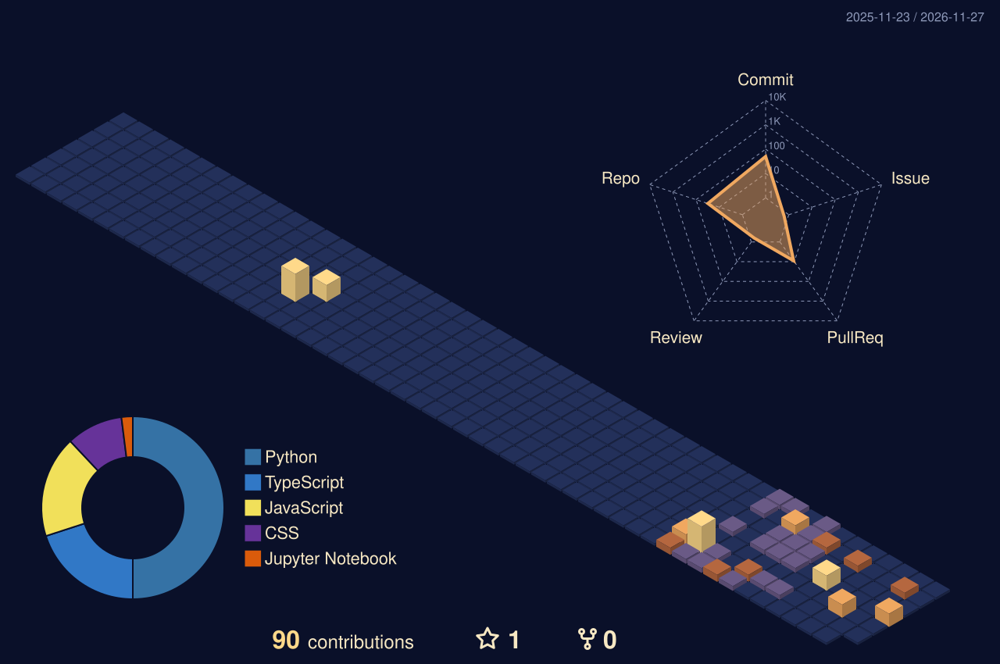

  

  <h3>Hi, I'm Vinh</h3>
  
Software Engineering student focused on Backend Development and AI Systems.

<table>
  <tr>
    <td width="50%" valign="top">
      <h3> About</h3>
      
<b>Building</b> AI Gateway and backend projects

      
<b>Learning</b> AI Agents, LLMs, System Design

      
<b>Goal</b> Backend / AI Engineer

    </td>
    <td width="50%" valign="top">
      <h3> Tech stack</h3>
      
<b>Backend</b> <code>Java</code> <code>Spring Boot</code> <code>Python</code> <code>FastAPI</code>

      
<b>Database</b> <code>PostgreSQL</code> <code>SQL Server</code>

      
<b>Tools</b> <code>Git</code> <code>Docker</code> <code>Postman</code> <code>Linux</code>

    </td>
  </tr>
</table>

<h3> Contributions</h3>

<h3> Overview</h3>

<!-- overview:start -->

| Contributions this past year | Active days | Longest streak | Best day |
| :---: | :---: | :---: | :---: |
| **85** | **33** | **5 days** | **14 on Sep 18** |

| Top languages | Code | Commits |
| :---: | :---: | :---: |
| Python | 51% | 20 |
| Jupyter Notebook | 23% | 1 |
| TypeScript | 14% | 10 |
| CSS | 7% | 5 |
| Java | 3% | - |
| JavaScript | <1% | 9 |

<!-- overview:end -->

Refreshed daily. Languages and commits cover public repositories; commits count toward each repository's main language over the last 12 months.

