  

  <h3>Hi, I'm Vinh</h3>
  
Software Engineering student focused on Backend Development and AI Systems.

<table align="center">
  <tr>
    <td width="50%" align="center" valign="top">
      <h3> About</h3>
      
<b>Building</b> AI Gateway and backend projects

      
<b>Learning</b> AI Agents, LLMs, System Design

      
<b>Goal</b> Backend / AI Engineer

    </td>
    <td width="50%" align="center" valign="top">
      <h3> Tech stack</h3>
      
<b>Backend</b> <code>Java</code> <code>Spring Boot</code> <code>Python</code> <code>FastAPI</code>

      
<b>Database</b> <code>PostgreSQL</code> <code>SQL Server</code>

      
<b>Tools</b> <code>Git</code> <code>Docker</code> <code>Postman</code> <code>Linux</code>

    </td>
  </tr>
</table>

<h3> Contributions</h3>

