<div align="center">
  
</div>

### Hi, I'm Vinh

Software Engineering student focused on Backend Development and AI Systems.

```text
   /\_/\        vinh@github
  ( o.o )       ------------------------------------------
   > ^ <        Role       Software Engineering student
  /     \       Building   AI Gateway & backend projects
 |       |      Learning   AI Agents, LLMs, System Design
 |  | |  |      Backend    Java, Spring Boot, Python, FastAPI
 (__|_|__)_/    Database   PostgreSQL, SQL Server
                Tools      Git, Docker, Postman, Linux
                Goal       Backend / AI Engineer
```

### Inventory

<div align="center">
  
</div>

<br>

<div align="center">
  
</div>
